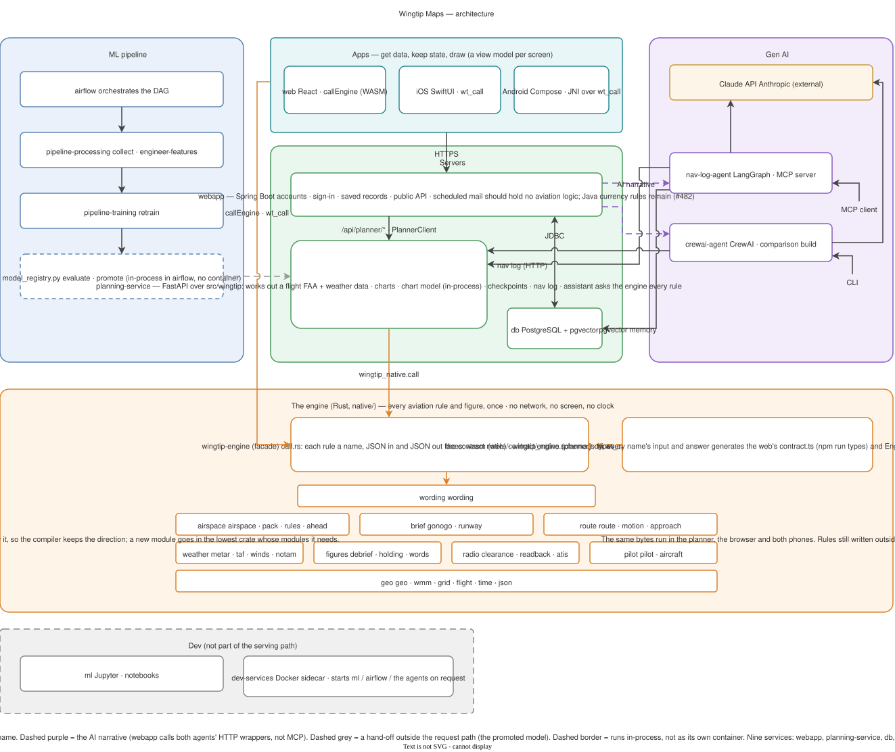

# Wingtip Maps


**The map for flying.** Every airport and airspace on the FAA chart, on one map that works like Maps on an iPhone — and, when you go somewhere, the route, the checkpoints you'll see and the nav log.

[](https://github.com/asdaq-samir/wingtip/actions/workflows/ci.yml)
[](LICENSE)

Built with Rust, TypeScript and React, Swift, Kotlin, Python (FastAPI) and Java (Spring Boot), on PostgreSQL, Docker and AWS, with the Claude API.

## A planning aid

Wingtip Maps is a planning aid for VFR and IFR flight. It does not replace an official weather briefing (1800wxbrief.com or 1-800-WX-BRIEF), current FAA charts and publications, or the pilot in command's judgement and final authority (14 CFR 91.3, 91.103). Its checkpoints are a model's suggestions: check them against the chart. The app says so on first launch and under Settings, About & limits.

## Quick start

```bash
git clone https://github.com/asdaq-samir/wingtip.git
cd wingtip

docker compose up webapp          # UI + API at http://localhost:8080/app
```

No API key is needed for any of that. The two services that call Claude — `nav-log-agent` and `crewai-agent` — sit behind a Compose profile (`docker compose --profile ai up`) and want an `ANTHROPIC_API_KEY` of your own; nothing else does.

Everything else — `ml`, the training run, `nav-log-agent`, `crewai-agent`, and the full prerequisite/setup guide — is in [`docs/README.md#getting-started`](docs/README.md#getting-started). No native Python, Node, or Java toolchain is required; every service builds its own image.

## Architecture



Four layers, each with one job, so a rule is written once and every app
gets the same answer:

| Layer | Where | Its job |
|---|---|---|
| The engine | [`native/`](native) (Rust) | Every aviation rule and figure, once: altitudes, winds, runways, fuel, weather limits, Go / No-Go, holds, procedures (currency is to join them, #482). No network, no screen, no clock. A facade (`wingtip-engine`) over nine domain crates; each rule is a name in `native/engine/src/call.rs`, JSON in and out, typed by a contract (`native/contract/engine.schema.json`) the apps' types are generated from. |
| The planner | [`planning-service/`](planning-service) over [`src/wingtip`](src) (FastAPI) | Works out a flight: fetches the FAA and weather data, reads the chart and scores its checkpoints with the chart model, runs the AI assistant, and asks the engine every rule. |
| Spring Boot | [`springboot-app/`](springboot-app) | Who the pilot is and what they saved: accounts, sign-in, records, the public API, scheduled mail. Should hold no aviation logic, asking the planner (which asks the engine) for a figure; the currency rules are still Java until #482 moves them. |
| The apps | [`web/`](web), [`ios/`](ios), [`android/`](android) | Get data, keep state, draw (a view model per screen), and ask the engine the rest: the web as WebAssembly, the phones through its C interface. |

Two server languages stay, on that line (the owner, 2026-11-06): the
boundary between them is plain HTTP, merging them would give a pilot
nothing, and Spring is good at identity and persistence. Some rules still
live outside the engine, in the Python, the Java and the apps; issue #482
moves them in, in order.

| Service | Role |
|---|---|
| `webapp` | Spring Boot: accounts, sign-in, the pilot's records, the public API and scheduled mail; serves the React front end and proxies the planner |
| `planning-service` | FastAPI: works out a flight (charts, checkpoints scored by the chart model in-process, the nav log, weather, the assistant), the engine inside it |
| `nav-log-agent` | LangGraph agent, served over MCP — assembles the nav log and briefing |
| `crewai-agent` | The identical task in CrewAI, for framework comparison |
| `db` | PostgreSQL + pgvector — application data and agent long-term memory |
| `pipeline-processing` / `pipeline-training` | Data collection, feature engineering, and training, as one-off jobs; `retrain` is the whole training run in the training image, which the developer console starts |
| `ml` | Jupyter environment for model development -- on demand: `docker compose up ml` |

Eight services, one `docker compose up`. Full write-up, including the AWS target architecture, is in [`docs/README.md`](docs/README.md).


## Under the hood

**A production-shaped platform that plans VFR and IFR cross-country flights end to end** — a trained model picks visually identifiable ground checkpoints off a real FAA sectional chart, a dead-reckoning engine computes headings, groundspeed, ETE, and fuel burn from live weather, a rules engine selects a legal cruising altitude from terrain, airspace, and weather constraints, and a Gen AI agent turns all of it into a natural-language pilot briefing.

Demo route: **Campbell Airport (C81)** → **Duluth International (KDLH)**.

- **Checkpoints a pilot can see on the chart.** Candidates come from OpenStreetMap and the FAA's own data along the corridor, and a model trained on ratings made against the sectional scores which ones a pilot could actually spot. Picks made on the chart itself in the training workspace — where a chart-vision detector reads features straight off the sectional's raster tiles — become training labels for the candidates they land on.
- **scikit-learn model selection.** Each retrain grid-searches Ridge, Random Forest and Gradient Boosting against a predict-the-mean baseline on the same feature set, by 5-fold cross-validation, and keeps the best; the planner scores checkpoints with the promoted model. Notebook 03 adds nested cross-validation and permutation importance.
- **A repeatable training run.** One command (`python -m wingtip.pipeline run`, which the developer console's Retrain starts as a container) runs collection, feature engineering, training, evaluation, and promotion in order; a new model goes live only if it beats the currently deployed one on held-out metrics.
- **FAA-accurate flight planning.** Dead-reckoning legs (wind correction angle, true/magnetic heading, groundspeed, ETE, fuel burn) from live NOAA winds-aloft and magnetic-declination data. Cruising-altitude selection accounts for terrain/obstacle clearance (FAA MEF methodology), live Class B/C/D airspace, and current METAR/TAF/SIGMET data.
- **A Gen AI agent with long-term memory.** A LangGraph agent, served over MCP, assembles the full nav log into a natural-language briefing and recalls similar past routes via a Postgres/pgvector semantic-search store.
- **The same agent, two frameworks.** A second implementation in CrewAI runs the identical task — same tools, same planner behind them, same Claude API — so LangGraph's explicit state-graph control flow and CrewAI's agent-driven tool selection can be compared on one real task, side by side, from the UI.
- **A cheap path to production.** One server behind CloudFront runs the webapp, the planner, the briefing agent and Postgres, and a Fargate Spot task draws each 56-day chart cycle once into S3 for the edge to serve: about $29 a month with the server on Spot capacity, in one CloudFormation template ([`docs/README-AWS.md`](docs/README-AWS.md) has the design, the cost and the runbook).


## Project layout

| Path | Contents |
|---|---|
| [`web/`](web) | The web app: React 19, TypeScript and MapLibre |
| [`ios/`](ios) | The native iOS app: SwiftUI over the shared Rust engine (docs/NATIVE.md) |
| [`android/`](android) | The native Android app: Kotlin, Compose and MapLibre over the shared Rust engine (docs/NATIVE-ANDROID.md) |
| [`native/`](native) | The shared Rust engine: every aviation rule once, in nine crates behind one facade, its contract, and its Python, C and WebAssembly faces |
| [`planning-service/`](planning-service) | The planner's HTTP layer: route planning, chart vision, the chart model, the assistant |
| [`springboot-app/`](springboot-app) | Accounts, sign-in, the pilot's records, the public API |
| [`nav-log-agent/`](nav-log-agent) | LangGraph briefing agent |
| [`crewai-agent/`](crewai-agent) | CrewAI briefing agent |
| [`src/`](src) | The planner's Python package (`wingtip`): data, charts, pipeline, model registry, and the nav log until it moves into the engine |
| [`infra/`](infra) | AWS CloudFormation and the production server's files |
| [`notebooks/`](notebooks) | Numbered, run-in-order exploratory notebooks |
| [`docs/`](docs) | Full documentation, AWS deployment guide, architecture diagrams |

## Documentation

| | |
|---|---|
| [`CONTRIBUTING.md`](CONTRIBUTING.md) | How to run it, where a change goes, the checks, and how a change lands |
| [`docs/README.md`](docs/README.md) | Architecture, service reference, data design, developer guide |
| [`docs/README-AWS.md`](docs/README-AWS.md) | AWS target architecture and deployment |
| [`docs/CI.md`](docs/CI.md) | What CI runs and when, and how to run it on the Mac mini |
| [`docs/GOOGLE-MAPS.md`](docs/GOOGLE-MAPS.md) | The map's overlays over the chart: the USGS's imagery, and Google's map and satellite with the owner's key |
| [`docs/TV.md`](docs/TV.md) | The TV apps for Samsung (Tizen) and LG (webOS): the site made for a remote, their packages, and the owner's store steps |
| [`docs/NATIVE.md`](docs/NATIVE.md) | The native iOS app: SwiftUI over the shared engine, its rules and fixtures, and its build and tests on the macOS runner |
| [`docs/NATIVE-ANDROID.md`](docs/NATIVE-ANDROID.md) | The native Android app: Compose and MapLibre over the shared engine, its build and emulator tests on the Linux runner |
| [`docs/LEARNING-GUIDE.md`](docs/LEARNING-GUIDE.md) | Guided walkthrough of the system, section by section |

## License

[`LICENSE`](LICENSE)
