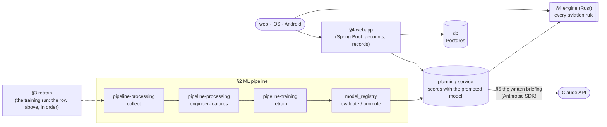
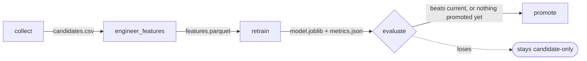
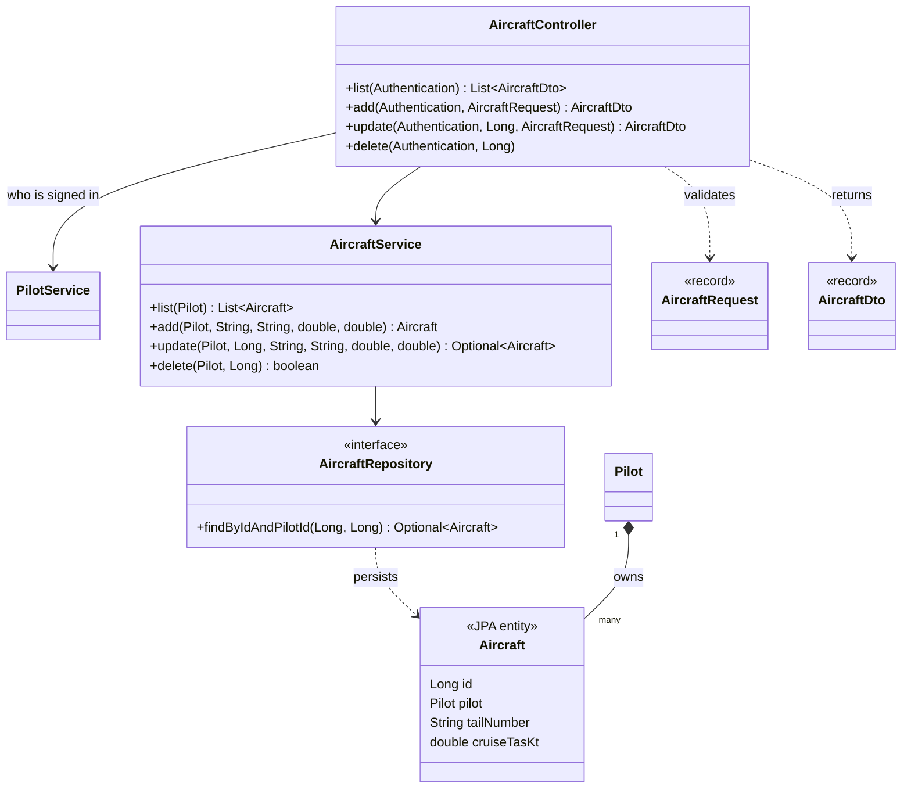

# Learning Guide

## Contents

- [Overview](#overview)
- [1. Docker fundamentals](#1-docker-fundamentals)
- [2. The ML pipeline](#2-the-ml-pipeline)
- [3. Running the pipeline](#3-running-the-pipeline)
- [4. The serving layer](#4-the-serving-layer)
- [5. The Gen AI layer](#5-the-gen-ai-layer)
- [6. Database migrations](#6-database-migrations)
- [7. Infrastructure as code (CloudFormation)](#7-infrastructure-as-code-cloudformation)
- [8. What gets tested, and what deliberately doesn't](#8-what-gets-tested-and-what-deliberately-doesnt)
- [Suggested order to build this yourself](#suggested-order-to-build-this-yourself)
- [Appendix](#appendix)

## Overview

A teaching document; `README.md` is the reference. This explains *why*
the repo is built the way it is, concept by concept, so you walk away
able to rebuild something like it yourself. Each section introduces an
idea, then shows exactly where in this repo that idea shows up.

Read it top to bottom the first time; come back to individual sections
later as a refresher while you build.

The project has four layers, each with one job. The Rust engine
(`native/`) holds every aviation rule and figure once, with no network,
no screen and no clock. The planner (`planning-service` over
`src/wingtip`, FastAPI) works out a flight: it fetches the data, runs the
chart model and the assistant, and asks the engine every rule. Spring
Boot (`webapp`) is who the pilot is and what they saved, with no aviation
logic of its own. The apps (web, iOS, Android) get data, keep state and
draw, and ask the engine the rest. §4 says why it is cut this way.

The services, one picture. Each box is a Docker service, except the
apps, `model_registry` (code the training run calls) and the engine, which runs
inside the planner and inside each app; every arrow is covered by name
in the section noted next to it:



Everything above `db`/`planning-service` runs today exactly as drawn; the
`§7` CloudFormation template re-provisions this same picture on AWS,
service for service — see `docs/README-AWS.md`.

---

## 1. Docker fundamentals

Everything in this project runs in Docker. Before touching this repo's
Dockerfiles, you need four ideas solid:

**Image vs. container.** An image is a frozen filesystem snapshot plus
metadata about how to run it — think of it as a class. A container is a
running (or stopped) instance of that image — an object. `docker build`
produces an image; `docker run` (or `docker compose up`) produces a
container from it.

**Layers.** A Dockerfile is a sequence of instructions, and each one
(`RUN`, `COPY`, etc.) produces a new filesystem layer, cached and stacked
on the previous one. If you change a line near the top of a Dockerfile,
every layer below it gets rebuilt — Docker can't know the change didn't
affect them. That's why `COPY requirements.txt .` followed by `RUN pip
install` almost always comes *before* `COPY app ./app` in this repo's
Dockerfiles: your application code changes constantly, your dependency
list doesn't, so putting the slow, cacheable step (`pip install`) first
means it's skipped on rebuild unless `requirements.txt` itself changed.
Look at [`planning-service/Dockerfile`](../planning-service/Dockerfile) — that
ordering is deliberate, not incidental.

**Volumes vs. the image filesystem.** Anything `COPY`'d into an image is
frozen at build time. A volume (or bind mount) instead maps a directory on
your host machine into the running container, live. This repo uses bind
mounts heavily — `.:/workspace` shows up in several services in
[`docker-compose.yml`](../docker-compose.yml) — specifically so you can
edit Python source on your host and rerun the container without rebuilding
the image. Compare that to `webapp`, which has *no*
bind mount: its code is `COPY`'d into the image at build time, so you
must rebuild the image to pick up a change. That split is a real decision:
interpreted-language dev containers favor mount-and-iterate; compiled/
packaged services (a Spring Boot JAR, a pip-installed FastAPI app meant to
mirror a real deployable artifact) favor rebuild-and-run, closer to how
they'd actually ship.

**Networking.** Docker Compose puts every service in the same file on one
private network, and each service is reachable from any other by its
*service name* as a hostname — not `localhost`. That's why
[`docker-compose.yml`](../docker-compose.yml)'s `planning-service` has
`AIRFLOW_URL: http://airflow:8080`, not
`http://localhost:8081` — `airflow` is DNS-resolvable to the right
container only inside that private network. From your host machine
(outside Compose's network), you *do* use `localhost:8080` etc., because
`ports: ["8080:8080"]` punches a hole from the host into the container.

### Reading a Dockerfile

Six instructions cover almost everything you'll see here:

| Instruction | What it does |
|---|---|
| `FROM` | The base image to start from |
| `WORKDIR` | Sets the working directory for everything after it |
| `COPY <host> <container>` | Copies files from your build context into the image |
| `RUN` | Executes a command *at build time*, baking its result into a layer |
| `ENV` | Sets an environment variable, baked into the image |
| `EXPOSE` | Documentation only — doesn't actually publish a port; `ports:` in Compose does that |
| `CMD` / `ENTRYPOINT` | What runs when a container starts (not at build time) |

`CMD` vs `ENTRYPOINT`: `ENTRYPOINT` is the fixed command; anything passed
to `docker run <image> <args>` (or Compose's `command:`) gets appended as
arguments to it. `CMD` is the *whole* default command, fully overridable.
This repo uses `ENTRYPOINT` for the pipeline images specifically so
`docker compose run --rm pipeline-training retrain` can pass `retrain` as
an argument to a fixed `python3 -m wingtip.pipeline` — see
[`docker/Dockerfile.training`](../docker/Dockerfile.training).

### Multi-stage builds

[`springboot-app/Dockerfile`](../springboot-app/Dockerfile) is the one
multi-stage build in this repo, trimmed here to its shape:

```dockerfile
FROM node:26-slim AS web
COPY web/ ./
RUN npx vite build --outDir /web/dist

FROM maven:3.9.16-eclipse-temurin-25 AS build
COPY springboot-app/src ./src
RUN mvn -q package -DskipTests

FROM eclipse-temurin:25-jre
COPY --from=build /build/target/*.jar app.jar
COPY --from=web /web/dist ./static/app
ENV APP_STATIC_LOCATION=file:/app/static/app/
CMD ["java", "-jar", "app.jar"]
```

Three `FROM` lines means three stages. The first has Node and builds the
React bundle; the second has the full Maven toolchain (hundreds of MB)
and compiles a JAR; the third starts fresh from a much smaller JRE-only
base image and copies in just the JAR and the bundle (`COPY
--from=build`, `COPY --from=web`), which Spring serves from that
directory. None of Node, Maven, the `.m2` cache or the source files make
it into the final image. This is the standard pattern for any compiled
language in Docker: build fat, ship thin. The first two stages are
independent of each other, so a front-end change never re-runs Maven and
a Java change never re-runs Vite -- BuildKit replays the untouched stage
from its cache.

### Every Dockerfile in this repo, and why it's shaped that way

| Dockerfile | Base | Why it looks like this |
|---|---|---|
| [`docker/Dockerfile.ml`](../docker/Dockerfile.ml) | `python:3.14-slim` | Jupyter and scikit-learn over `wingtip`'s own list, for notebooks 01–03 and 08, and nothing else: the PyTorch, TensorFlow, Spark and sentence-transformers comparison notebooks, and the JDK and CUDA-free torch wheel they needed, went on 2026-11-06, since only scikit-learn reaches a pilot. Carries no source; compose bind-mounts the checkout. |
| [`docker/Dockerfile.processing`](../docker/Dockerfile.processing) | `python:3.14-slim` | Deliberately thin: pandas/requests/pyarrow only, no scikit-learn. Mirrors what a SageMaker *Processing Job* container needs. |
| [`docker/Dockerfile.training`](../docker/Dockerfile.training) | `python:3.14-slim` | Adds scikit-learn/joblib on top, so it can run every stage: the training run (`python -m wingtip.pipeline run`, compose's `retrain`) runs in it. Kept as a *separate* image from `.processing` rather than one shared image, because Processing and Training are different constructs on AWS with different container contracts — see [Section 2](#2-the-ml-pipeline). |
| [`planning-service/Dockerfile`](../planning-service/Dockerfile) | `python:3.14-slim` | FastAPI plus the chart-vision stack (numpy, Pillow, shapely), and the chart model's scikit-learn, pinned to the training image's. Bind-mounts the repo, so a `src/wingtip` edit needs a restart, not a rebuild. |
| [`springboot-app/Dockerfile`](../springboot-app/Dockerfile) | `node:26-slim` → `maven:...` → `eclipse-temurin:25-jre` | Multi-stage, see above. |

### The images those Dockerfiles produce

A Dockerfile is a recipe; an image is the baked result sitting on your
disk. `docker images` on a working copy of this repo shows two kinds.

**The ones built from this repo**, named after the project
(`wingtip-webapp`, `wingtip-ml`, and so on). Only three of them run the application — `webapp`,
`planning-service` and the database's own image below;
the rest exist for building, training or testing.

**The ones pulled, not built.** These look like clutter and are not;
deleting one only forces a re-download on the next build. `python:3.14-slim`
is the base for most of those above, stored once, which is why image
sizes are not additive. `node:26-slim` and `maven:...` are build-only and
never ship. `pgvector/pgvector` is the database. `postgres` and
`testcontainers/ryuk` are started by the JUnit suite ([Section 8](#8-what-gets-tested-and-what-deliberately-doesnt)).
Intermediate build stages such as `eclipse-temurin:25-jre` do not appear
in the list at all under the containerd image store.

#### The disk lesson

No image is permanently *needed*. Each one is a cache of a build this
repo can reproduce, so deleting one costs rebuild time, never data. The
thing you must not delete is the named Postgres volume (`pgdata_pg18` in
`docker-compose.yml`), which holds the application rows — and `docker system prune --volumes`, the command everyone
reaches for when a disk fills, takes it with everything else.
[`docker/tidy.sh`](../docker/tidy.sh) is the safe version: by default it
removes stopped containers and build-cache entries unused for seven
days, never volumes or images; `--aggressive` also removes unused images.

Two things fill the disk that are not the images. Build cache, which
`docker system df` under-reports badly (`docker builder prune` shows the
real number). And the default GPU build of `torch`, which
`sentence-transformers` pulls in: several GB of CUDA libraries in an image
that runs on a laptop and deploys to Fargate. Every Dockerfile here that
needs torch installs the CPU wheel explicitly for that reason.

### Reading `docker-compose.yml`

Open [`docker-compose.yml`](../docker-compose.yml) side by side with this.
Per service, four keys matter most:

- `build:` — where the Dockerfile is and what directory is the *build
  context* (everything `COPY` can see). Some services build from `.` (the
  repo root, needed when the Dockerfile has to `COPY src ./src` from
  outside its own directory); a fully self-contained one could build from
  its own subdirectory instead.
- `ports: ["8080:8080"]` — `host:container`. The left side is what you
  type into your browser; the right side is what the app inside actually
  binds to.
- `environment:` — env vars injected into the container. Notice
  `${ANTHROPIC_API_KEY:-}` on `planning-service`: `:-` means
  "empty if unset". Its sibling `${VAR:?message}` means "fail immediately
  with this message if unset", and this file used that until it was tried
  from a clean checkout — Compose interpolates the *whole* file before it
  decides which services to start, so one required-variable marker failed
  every command, including `docker compose up webapp` and even
  `docker compose config`. A worked lesson in where a check belongs: the
  planner's Claude features now find the key missing when they are used,
  and say so, so the failure reaches only the people using them.
- `profiles:` — a service with a profile is left out of a plain
  `docker compose up`. `--profile notebooks` includes `ml`, and naming the
  service directly enables its profile too.
- `depends_on:` — controls **start order** only (Compose waits for the
  dependency's container to start, not for the app inside it to be
  ready). It does not retry connections — if `webapp` starts faster than
  `db` accepts connections, that's on `webapp`'s own connection-retry
  logic (Spring Boot's, in this case), not Compose.

---

## 2. The ML pipeline

This is the automatable subset of what a data scientist does by hand,
turned into three plain functions in
[`src/wingtip/pipeline.py`](../src/wingtip/pipeline.py): `collect`,
`engineer_features`, `retrain`. Plus two more in
[`src/wingtip/model_registry.py`](../src/wingtip/model_registry.py): `evaluate`,
`promote`. Five functions, five pipeline stages, one per notebook (01, 02,
03, 03, 03).



This is the exact shape Section 3's training run automates, stage for stage.

### Two ways to find a checkpoint, and why the second one exists

Everything below describes the tabular pipeline: ask OpenStreetMap and the
FAA what is near the route, turn each answer into a row of numbers, learn
from those. It is the version to read first, because every ML idea in this
project lives in it.

But it has a flaw that took a while to see. The thing being predicted is
"could a pilot spot this **on the sectional chart**", and OSM is not the
chart. So the pipeline kept needing rules to force the two together:
towers dropped because the chart draws every obstacle with one symbol,
water towers dropped because 16 of 17 were not drawn at all, quarries
dropped, unnamed lakes dropped because one blue shape among identical
blue shapes cannot be confirmed as the right one. Each was a real
discovery, and each was a patch over the same mismatch.

[`src/wingtip/chartvision.py`](../src/wingtip/chartvision.py) removes the
mismatch by reading the chart. A sectional is a cartographic product with
a fixed palette, so the tiles can be segmented directly: pale blue is
water, a saturated dark blue line is a watercourse, yellow is a town,
near-black is linework. What the chart does not draw is not found, so
none of those exclusion rules needs to exist.

Two details in it are worth more than the colour thresholds. A linear
feature is reported where the course **crosses** it, not at its centroid —
the centroid of a river that wanders across a mosaic is a point in a field
somewhere, and the same realisation is already in `wingtip.osm`'s
`find_line_crossings`. And chart text is drawn in the same ink as roads,
so "Nepco Lake" and every airport name produced crossings until the
detector started requiring the thing under one to actually run somewhere:
the median near-black blob is one pixel across, while a real road runs for
hundreds.

It is faster for the same reason it is more accurate — 320 nm of corridor
in about five seconds against minutes of Overpass and FAA downloads —
but speed is the side effect. Making the ground truth and the training
signal the same artefact is the point.

### Collect → raw candidates

`collect()` pulls real-world geographic features along a flight corridor
(rivers, railroads, road intersections, named lakes, wind farms, towns,
stadiums, plus airports and VOR navaids) from OpenStreetMap's Overpass
API and the FAA's NASR data, filters them to a corridor around a
straight line between two airports,
and writes them to `data/processed/candidates_c81_kdlh.csv`. If you're new
to geospatial code, the two ideas worth understanding here are
**cross-track distance** (how far off the direct line a point is) and
**along-track distance** (how far along the line, projected) — both live
in [`src/wingtip/geo.py`](../src/wingtip/geo.py) and are standard great-circle
navigation math, not anything ML-specific.

Which categories are collected is itself a data-quality decision, and the
rule is narrower than "anything visible from a plane": a candidate is
only worth collecting if a pilot can **identify it on the sectional**,
because that is what the 1-5 label is judging. Towers, water towers,
quarries and unnamed lakes were each collected at some point and then
removed against that rule — a sectional draws every obstacle with one
symbol, and an unnamed lake is one blue shape among identical blue
shapes, so neither can be confirmed as *the* feature the marker points
at. Golf courses and forest preserves fail the same test for the opposite
reason: at 1:500,000 the chart draws no boundary for them at all, so even
a 100 km² forest is invisible. Airports go the other way and come from
the FAA's `APT_BASE.csv` rather than OSM or OurAirports, because being
FAA-registered is what tracks with being drawn: two unregistered private
strips had nothing at all at their coordinates, while a registered
private field is drawn as a circled magenta "R". See `CANDIDATE_SPECS` in
[`src/wingtip/osm.py`](../src/wingtip/osm.py), where every exclusion is recorded
next to the ones that stayed.

### Engineer features → a model-ready table

`engineer_features()` turns those raw candidates into numeric columns a
model can actually consume — this is **feature engineering**, the step
between "raw real-world data" and "what a model sees." Concretely:
one-hot encoding the categorical `category` column
(`pd.get_dummies` → `category_river`, `category_lake_or_pond`, etc.), a
log-transformed size feature (`log_size`, since raw area is heavily
skewed — a few huge lakes would otherwise dominate a linear model), a
computed "elevation prominence" (how much a point stands out from its
surroundings — useful for spotting it from the air), a name-uniqueness
score, and nearest-neighbor distance (how close the next candidate is —
two features that are practically on top of each other are less useful
individually). Result: `data/processed/features_c81_kdlh.parquet`.

### Retrain → model selection

This is the part worth slowing down on if machine learning is new to you.
`retrain()` ([`src/wingtip/pipeline.py`](../src/wingtip/pipeline.py))
does five things, in order, and each is a standard ML pattern you'll see
in any serious project:

1. **Train/test split.** `train_test_split(X, y, test_size=0.2, ...)` sets
   aside 20% of the labeled data that the model *never* sees during
   training. Every metric that matters gets computed on this held-out
   slice — training-set performance tells you almost nothing about how a
   model will do on new data.
2. **Cross-validation, not a single fit.** Within the training set, `KFold(n_splits=5)`
   splits it five ways and fits/scores five times, rotating which slice is
   the validation fold. This gives a much more stable estimate of a
   model's real performance than one lucky (or unlucky) split would.
3. **Hyperparameter search.** `GridSearchCV` tries every combination in a
   parameter grid (e.g. Ridge's `alpha`, RandomForest's `max_depth` and
   `min_samples_leaf`) and keeps whichever combination scored best across
   the 5 folds. This is *inside* the cross-validation loop — the model
   never gets to "peek" at test data while tuning itself.
4. **Compare multiple model families against a dummy baseline.** Ridge
   (linear), RandomForest, and GradientBoosting (both tree ensembles) are
   all grid-searched, and a `DummyRegressor(strategy="mean")` — a model
   that just always predicts the average — is scored the same way. If your
   real models can't beat "always guess the average," something's wrong;
   this baseline is the sanity check.
5. **Final fit + honest scoring.** Whichever model won cross-validation
   gets refit on the *full* training set, then scored exactly once against
   the untouched test set (MAE, RMSE, R²). That held-out score — not the
   CV score — is what actually gets compared during promotion, below.

The model and its metrics are saved to `data/models/candidate/` — notice
the word "candidate," not "current." That distinction is the whole point
of the next step.

**One deliberate guardrail**: `retrain()` refuses to run at all below 30
labeled rows (`MIN_LABELED_ROWS`), raising a clear
`InsufficientLabelsError` instead of letting scikit-learn fail with an
opaque stratification error on a handful of rows. Fail loud, fail early,
fail with a message a human can act on — that's a pattern worth copying
into your own pipelines generally.

It also earned its keep as a *measurement*. At 37 labels the model beat a
predict-the-mean baseline by 0.06% — statistically nothing. At the full
206 it beats it by 11%. The guard's real message is that a model trained
on too little data does not announce itself with an error; it announces
itself by quietly matching the mean.

### Evaluate/promote → a tiny model registry

[`src/wingtip/model_registry.py`](../src/wingtip/model_registry.py) implements the
**champion/challenger pattern**: `evaluate()` compares the freshly-trained
"candidate" model against whatever's currently "current" (serving), and
returns `True` only if the candidate wins (or nothing has been promoted
yet). `promote()` then copies the candidate into the `current/`
directory — which the planner really does score from, reading it
again when it changes — and also stashes a timestamped copy under `versions/` for history.
**A new model only goes live if it's measurably better than what's
already live** — this is the single idea that makes an automated
retraining pipeline safe to run unattended instead of silently degrading
production every time it fires.

**Which metric you gate on matters as much as having a gate**, and this
one got it wrong at first. `evaluate()` originally compared
`held_out_mae`, the score on a single train/test split. The first real
decision it ever made rejected a candidate on a gap of 0.0669 — and
recomputing that same statistic across 50 different split seeds, for one
unchanged model, gave a standard deviation of 0.068 and a range from 0.73
to 1.09. The gate was reading noise as signal: across those 50 splits the
two models it was comparing won 25 each. It now gates on `cv_mae`, the
mean across 5 cross-validation folds, which is also what `retrain()`
already used to choose between model families — selecting on one metric
and gating on another was its own quiet inconsistency. The lesson
generalizes: before trusting a comparison, measure how much your
comparison statistic moves when nothing changes.

Notice this module has **zero third-party dependencies** — no pandas, no
scikit-learn, just `json`/`shutil`/`pathlib` from the standard library.
That's deliberate: `evaluate`/`promote` are pure bookkeeping (compare two
numbers, copy two files), not real computation, so they don't need a
heavy environment — the planner imports this module too, to report
the model serving, without pandas or scikit-learn of its own.

---

## 3. Running the pipeline

The five stages run in order, every time, from one command:

```bash
docker compose run --rm pipeline-training run    # python -m wingtip.pipeline run
```

Open `run()` in [`src/wingtip/pipeline.py`](../src/wingtip/pipeline.py).
It is a list of stages per model -- the landmark model's
`landmarks_ready`, `collect`, `feature_engineer`, `retrain`, `evaluate`,
`promote`, then the chart model's `chart_retrain`, `chart_evaluate`,
`chart_promote` -- run one after another. Three rules carry the
weight:

- **A stage with nothing to do skips the rest of its branch.** Too few
  ratings, or a candidate that does not beat the model serving
  (`model_registry.evaluate()` false): promote never runs, the promoted
  model keeps serving, and the run is still a success.
- **A stage that fails fails its branch, not the other model's.** The
  run carries on to the chart model and ends "failed".
- **One run at a time.** `evaluate` reads the candidate and `promote`
  copies it later, from one fixed place; a second run's `retrain` in
  between would promote a model that never passed the gate. A lock file
  beside the status file makes a second run wait for the first.

As it goes, the run writes each stage's state to `data/models/run.json`.
That file is how the developer console follows it: the console's
Retrain asks the planner (`POST /api/retrain`), which asks the
dev-services sidecar -- the one process holding the Docker socket -- to
start compose's `retrain` container, and `/api/status` reads the file
beside the container's state.

**Why not an orchestrator.** This ran as an Apache Airflow DAG until
2026-11-06. The DAG had no schedule: it was started by hand, from the
same Retrain button. For that, the stack ran Airflow's scheduler, web
server and metadata database, and two images of its own (one with
`DockerOperator` launching the pipeline images as sibling containers
over the host's Docker socket, one launching SageMaker jobs for AWS).
Nine functions in a fixed order do not need a scheduler; a plain
function and a container give the same order, the same promotion gate
and the same one-at-a-time rule, with nothing to run between runs. An
orchestrator earns its place when there is a schedule, fan-out, retries
across machines or many pipelines to watch; reach for one then.

`pipeline-processing` and `pipeline-training` stay separate images, and
each stage still runs alone (`docker compose run --rm pipeline-processing
collect`): the split mirrors SageMaker's Processing and Training Jobs,
which is why `retrain()` still reads `SM_CHANNEL_*` and `SM_MODEL_DIR`
when they are set.

---

## 4. The serving layer

Two services answer real HTTP requests: `planning-service` (working out
a flight, and the model's predictions) and `webapp` (who the pilot is
and what they saved). Under both, and under every app, is the engine.

### Four layers, and why

- **The engine** ([`native/`](../native/README.md)) is a Rust library
  with no network, no screen and no clock: give it JSON by a rule's
  name (`native/engine/src/call.rs`), get JSON back. It is a facade over
  nine crates, each allowed to use only the ones under it, so the
  compiler keeps geography from reaching for the Go / No-Go. The same
  bytes run in the planner (PyO3), in the browser (WebAssembly) and on
  both phones (a C interface), so a pilot's figure is the same offline
  in the air as on the planner's desk. A JSON Schema per name
  (`native/contract/engine.schema.json`) types the boundary, and each
  app's types are generated from it.
- **The planner** does what needs the network and the big data: the
  FAA's files, the weather, the chart tiles, the chart model, Claude.
- **Spring Boot** does identity and persistence: sign-in, sessions,
  Flyway's schema, the pilot's records, scheduled mail. When it needs a
  figure it asks the planner, which asks the engine.
- **The apps** are view and view model per screen, and hold no rules.

Why two server languages, rather than one: the owner weighed folding
one into the other on 2026-11-06 and kept both. The line between them
is plain HTTP and already clean, a merge would change nothing a pilot
sees, and Spring is good at what it does here. What made the old shape
hard was rules written several times over -- in Python, Java,
TypeScript and Swift -- and that is fixed by moving them into the
engine, not by changing servers. Issue #482 lists what has not moved
yet, in the order it moves.

### Scoring in the planner

[`planning-service/app/chart_scorer.py`](../planning-service/app/chart_scorer.py)
is deliberately minimal: one function, `score_detections`, the chart
model's score for each detection the planner reads off the chart. The
model loads from `data/models/chart/current` and is read again when a
retrain promotes a new one there — no restart. With none promoted it
gives no scores, and the planner ranks the detections by the chart
palette's constants instead. It was a FastAPI service of its own,
`model-service`, until 2026-11-06: one container for one call whose only
caller was the planner, so it moved in-process, with scikit-learn pinned
to the training image's.

### Select → the checkpoints actually flown

A scored ranking is not a flight plan.
[`src/wingtip/checkpoints.py`](../src/wingtip/checkpoints.py) is the step between
them: `select_checkpoints()` walks the model's candidates highest-score
first and takes each one that sits at least `min_spacing_nm` from
everything already chosen. On C81→KDLH that turns 206 scored candidates
into 21 checkpoints and 20 legs, averaging 15.7 nm apart.

This step is worth its own section because its *absence* was invisible for
weeks. `predicted_score` was plumbed through the FastAPI response, the
Java DTO and a database column, and no code anywhere branched on it — the
briefing agents of the time zipped the entire candidate list into consecutive legs, producing a
205-leg "nav log". Every test passed, every service was healthy, and the
model's output decided nothing. When you add a model to a system, the
question that catches this is not "is the model good?" but **"what line of
code changes its behaviour because of the model's answer?"**

Two design notes. Selection is greedy rather than an optimal dynamic
program because there is no principled exchange rate between "a better
checkpoint" and "more even spacing" — and greedy has the property that
matters, which is that the best feature on the route never gets dropped to
tidy up spacing elsewhere. And a minimum score means a barren stretch
yields a genuinely long leg instead of a checkpoint the pilot will look
for and fail to see.

### webapp (Spring Boot)

Standard Spring Boot layering, and worth knowing even outside this
project since it's close to an industry-default shape:

- **Controller** ([`AircraftController.java`](../springboot-app/src/main/java/com/northflyers/wingtip/controller/AircraftController.java)) —
  the HTTP boundary. `@RestController` + `@RequestMapping("/api/aircraft")`;
  each method maps to one route+verb (`@GetMapping`, `@PostMapping`,
  `@PutMapping("/{id}")`, `@DeleteMapping("/{id}")`). Controllers should
  stay thin — this one resolves the signed-in pilot, calls into
  `AircraftService` and wraps the result in a `ResponseEntity`, no
  business logic.
- **Service** ([`AircraftService.java`](../springboot-app/src/main/java/com/northflyers/wingtip/service/AircraftService.java)) —
  the actual logic, and where pilot-scoping lives: every lookup goes
  through `findByIdAndPilotId`, so one pilot can never read or edit
  another's aeroplane by guessing an id.
- **Repository** (`AircraftRepository.java`) — a Spring Data JPA interface;
  you don't implement it, Spring generates the implementation at startup
  from the method names/annotations.
- **Domain** (`Aircraft.java`, `Pilot.java`) — the JPA entities, mapped
  to actual database tables.
- **DTO** (`AircraftRequest.java`, `AircraftDto.java`) — plain
  data-carrying objects for what crosses a boundary (an HTTP
  request/response), kept separate from the JPA entities so your API
  shape and your database shape are free to diverge. `AircraftDto` and
  `Aircraft` look almost identical, but staying two classes is the
  point: the entity carries its owning `Pilot` and the DTO deliberately
  does not, so a change to what the API exposes never silently ripples
  into the schema, and vice versa.



Where the model gets called is worth noticing by its absence: nowhere in
this service. Scoring a route belongs to `planning-service`, which
`webapp` only proxies (`PlannerProxyController`, `/api/planner/*`), and
planning-service scores in its own process
([`app/chart_scorer.py`](../planning-service/app/chart_scorer.py)), and the
written briefing is planning-service's too, told from the nav log the
page already shows, so there is one place a nav log is built.

**Schema ownership**: this app does *not* let Hibernate auto-generate or
alter its schema in a real environment (`ddl-auto: validate`, not
`update`) — the actual schema is owned by **Flyway**, versioned SQL files
under `src/main/resources/db/migration/V<N>__*.sql`, applied automatically
on startup and tracked in a `flyway_schema_history` table so Flyway always
knows exactly which migrations have run. This is the standard way to
manage a real production schema: `ddl-auto: update` is convenient for a
throwaway prototype and dangerous for anything you intend to keep running,
because it can silently alter or drop columns based on what your Java
entities currently look like.

**Health checks**: Spring Boot Actuator exposes
`/actuator/health/liveness` and `/actuator/health/readiness` — the two
checks a container orchestrator (ECS, Kubernetes, anything) needs:
*liveness* answers "is this process healthy, or should it be killed and
restarted," *readiness* answers "should traffic be routed to this
instance right now" (e.g. it might be alive but still warming up, or
temporarily unable to reach its database). Different questions, different
endpoints, on purpose.

---

## 5. The Gen AI layer

Every Claude call in this project is made from `planning-service` with the
Anthropic Python SDK directly — no agent framework in between. The
project once had two (a LangGraph agent served over MCP, with a pgvector
memory of past briefings, and the same task again in CrewAI, to compare
the frameworks); the owner removed both on 2026-11-06, because the
project is a product, not a framework showcase, and every feature they
offered was one SDK call.

### What "an agent" actually means here

The written briefing ([`app/narrative.py`](../planning-service/app/narrative.py),
`POST /api/briefing/narrative`) is the clearest case. Everything a pilot
reads in it — the checkpoints, each leg's legal cruising altitude from
real terrain/airspace/weather constraints, the dead-reckoning legs with
their climbs and the fuel check — is worked out by deterministic code
first, and the page already has it on screen. The *only* place an LLM is
called is the last step: turning those figures into plain prose. That's
worth internalizing: "AI-powered" doesn't mean "the LLM does everything,"
it usually means "deterministic code does the heavy lifting, and an LLM
handles the part that's genuinely about language."

The call itself is short: one `client.messages.stream(...)` with the
prompt built from the nav log, each text delta written out as a line of
newline-delimited JSON as it arrives, so the first sentence reaches the
phone in a second or two rather than the whole briefing after ten. A
failure (no key, a limit, the token cap reached mid-sentence) ends the
stream with an `error` line instead of half a briefing — a cut-off
briefing could end before its weather, and a pilot would take it as
whole.

### When the model does choose: the tool runner

The pilot's assistant ([`app/assistant.py`](../planning-service/app/assistant.py))
is the one place the model decides what to do next. It is given the
planner's own functions as tools (the plan, the weather at a field, the
briefing, the Go / No-Go, a hold's entry, a diversion) and the SDK's
tool runner loops: the model asks for a tool, the runner calls the
Python function and hands back the answer, until the model has what it
needs to write. Every figure in the answer still comes from the
planner's functions; the model chooses which to ask for and writes the
words. That is the whole of what an agent framework would add here, and
the SDK does it in one call.

---

## 6. Database migrations

The webapp owns the schema of the one `db` Postgres container:

**`webapp` uses Flyway** — an industry-standard migration tool. You add a
new file, `V<N>__description.sql`, and Flyway applies any files newer than
what it's already tracked (in a `flyway_schema_history` table) on next
startup, in version order, once each, forever. Never edit an already-applied
migration file — add a new one instead; Flyway (like every migration
tool) assumes each version's content is immutable once it's run anywhere.

A database made before 2026-11-06 also holds a `nav_log_agent` schema —
the removed briefing agent's memory and its own small migrations table.
Nothing reads it any more; it was left in place rather than dropped by a
new migration, since a destructive migration is a decision to take on
purpose.

The pattern Flyway replaces: letting your ORM auto-generate schema
changes at startup based on what your code currently looks like (JPA's
`ddl-auto: update`, or an ad-hoc `CREATE TABLE IF NOT EXISTS` on every
connection). That works fine until you need to *rename* a column, backfill
data, or run the same migration across multiple environments in a
guaranteed order — none of which "auto-generate from current code" can do
safely.

---

## 7. Infrastructure as code (CloudFormation)

[`infra/cloudformation/template.yaml`](../infra/cloudformation/template.yaml)
describes AWS resources declaratively — you write *what* should exist, not
a script of *how* to create it — and CloudFormation figures out the
create/update/delete order from the dependency graph implied by
`!Ref`/`!GetAtt` between resources. Core vocabulary, all present in this
template:

- **Parameters** — inputs supplied at deploy time (`PublicHost`,
  `ServerImageId`, etc.), so the same template can be deployed to
  different accounts and domains without editing it.
- **Resources** — the actual AWS objects to create (an EC2 server, a
  CloudFront distribution, an S3 bucket, ...). This is the bulk of any
  template.
- **Conditions** — boolean expressions (e.g. "was this optional parameter
  actually supplied?") used with `!If` to make a resource or property
  optional based on parameter values: the budget alarm exists only when
  `BudgetEmail` is given.
- **Outputs** — values (like the deploy role's ARN, or the command that
  draws the first chart cycle) surfaced after a successful deploy, so
  other tooling — or a human — can find them without digging through the
  console.

`cfn-lint` is a *static* validator — it checks the template's shape
against the AWS resource specification (required properties, valid enum
values, cross-references that don't resolve) without ever touching a real
AWS account, and CI runs it on every change to the template. It is a
genuinely useful first gate — it caught two real mistakes in this
template's rewrite: YAML anchors and aliases, which CloudFormation itself
rejects, and an apostrophe in a security group's description, which EC2
does not allow — but passing it is not the same as a template being
deployable: IAM permission gaps, account quotas and DNS that does not
resolve yet are only provable by actually running
`aws cloudformation deploy`.

### Patterns worth stealing from this template

The vocabulary above is generic. These are the specific decisions in
`template.yaml` that are worth understanding, because each one solves a
problem you'll meet in any real deployment
([`README-AWS.md`](README-AWS.md) has the whole design and its cost):

- **A CDN in front of one server, and only the CDN let in.** CloudFront
  serves the app's domain; the server takes HTTPS only from CloudFront's
  managed prefix list (a security group rule by name, not a list of
  addresses to keep up to date), and Caddy on the server refuses any
  request without the secret header CloudFront adds. Either alone could be
  got round; both together cannot without the secret.
- **Cache by what the answer says, not by path alone.** Chart tiles and
  the app's fingerprinted files use AWS's managed caching policy; the few
  API answers the same for every pilot use a policy that keeps them only
  as long as their own `Cache-Control` says, keyed without cookies so one
  pilot's answer can serve the next; everything else is not cached at all.
  The application decides what is shareable, and a test checks it.
- **Draw it once, not on every request.** The chart tiles are the same
  for every pilot for 56 days, so a scheduled Fargate task draws the whole
  pyramid once per cycle and publishes it to S3, and the always-on server
  never draws a tile. On Fargate Spot (up to 70% cheaper, interruptible),
  because a run that is stopped simply runs again the next day.
- **No NAT gateway.** The server and the task sit in a public subnet with
  public addresses and reach the FAA, Anthropic and AWS directly; a NAT
  gateway for a private subnet would cost more than the server.
- **Keep the state off the server.** The server is Spot capacity in an
  Auto Scaling group of one, so AWS may take it back at any time; what
  it keeps (the database, the planner's data) is on a data disk of its
  own that each new server attaches on its first boot, along with the
  fixed address. A lost server then costs minutes, not data. The
  machine image is still a parameter, not a lookup of "the latest" —
  a lookup is re-resolved on every stack update, and the server would
  change without anyone choosing to — and the backup bucket is kept if
  the stack goes (`DeletionPolicy: Retain`).
- **Secrets the stack makes, and one it does not.** The database
  password, and the origin's header are generated by
  Secrets Manager (`GenerateSecretString`), so no person ever sees them;
  the owner's own keys go in one secret filled in by hand, which the
  stack writes once and leaves alone.
- **Deploys with no stored keys.** GitHub Actions assumes the deploy
  role through GitHub's OIDC provider, limited to this repository's main
  branch, then pushes the images and runs the server's `deploy.sh` over
  SSM Run Command — no SSH key and no open port.
- **`iam:PassRole` is its own permission.** The scheduler that starts
  the chart refresh needs permission to *run* the task and, separately,
  to hand it its two roles. Forgetting the second is a classic
  first-deploy failure, and the error message rarely says "PassRole"
  plainly.

---

## 8. What gets tested, and what deliberately doesn't

Most projects this shape have a testing story that's either "everything is
mocked" or "there are no tests." This one draws the line by asking what a
given test would actually prove.

**Pure logic gets unit tests.** `tests/` (pytest) covers the
parts of `src/wingtip` that are functions of their inputs and nothing else:
great-circle math in `wingtip.geo`, engineered features, the
wind-correction-angle math in `wingtip.navlog`, `model_registry`'s
evaluate/promote decision, and the remote-URI guards. These are fast,
deterministic, and worth having because the math is genuinely easy to get
subtly wrong.

**Browser logic counts as pure logic.** The decisions the pages make —
which points a filter admits, what counts as rated, which way the arrows
step, which leg leaves a checkpoint — are functions of plain objects, so
[`web/src/features/train/logic.ts`](../web/src/features/train/logic.ts) and
[`web/src/features/plan/format.ts`](../web/src/features/plan/format.ts)
hold them and `vitest` covers them in under a second with no browser.
What is left in the components — binding Leaflet layers, rendering rows —
is the part where a test would mostly restate the code. The general
lesson is worth more than the JavaScript: when something is hard to
test, it is often because a decision and its rendering are tangled
together, and separating them is what makes both better.

**Rendering still has to be looked at.** A layout fault — the map
inheriting no height, so Leaflet fits the route against a container it
measured wrong — breaks no pure function and fails no unit test. So
`web/e2e/` renders the pages in a real browser, at a phone and a desktop
viewport, and checks what the DOM alone cannot: nothing overflows, the
header controls sit where they should, the sidebar starts closed.

**Contracts get slice tests.** `AircraftControllerTest` uses `@WebMvcTest`
with the service layer mocked, because what it's testing is the *HTTP
contract* — does a signed-out caller get a 401 rather than a redirect,
does a bad body produce a 400 with usable field errors, does a wrong
method produce a 405 rather than a leaky 500. Booting a database to
answer those questions would only slow them down.

**Integration points get real infrastructure.**
[`FlightPersistenceTest`](../springboot-app/src/test/java/com/northflyers/wingtip/FlightPersistenceTest.java)
starts an actual Postgres via Testcontainers, because the things it
verifies can only be verified against a real database: that Flyway's
migrations apply in order, that `ddl-auto: validate` agrees the JPA
entities match the schema those migrations produced, that the unique
constraints hold, and that selling an aeroplane leaves the flights
flown in it behind (`ON DELETE SET NULL`). An in-memory H2 would happily pass while the real
Postgres rejected the same SQL — which would make the test worse than
useless, since it would produce false confidence.

That middle claim is the valuable one. Entity/schema drift is a classic
production failure: someone adds a field to a JPA entity, forgets the
migration, and it only surfaces at deploy. Having `validate` run against
migrated schema *in CI* turns that into a failing build instead.

**Some things are left to manual verification, on purpose.** Anything
requiring live network calls or a trained model — `collect`,
`engineer_features`, `retrain`, `wingtip.altitude`, `wingtip.airspace` — isn't
unit-tested. Mocking the Overpass API or the FAA's data format would test
the mock, not the integration, and the real value in those paths is
whether live upstream data still parses. Those get exercised by running
them for real against the live route. Knowing *which* category a piece of
code falls into is most of the skill here.

---

## Suggested order to build this yourself

If you wanted to build a project like this from a blank repo, roughly this
order tracks how the pieces actually depend on each other (and matches
how this repo itself was actually built):

1. **Data + a notebook.** Get comfortable pulling and shaping real data
   before writing any pipeline code around it.
2. **Model selection, by hand, in a notebook.** Compare a few model
   families against a dummy baseline before automating anything.
3. **Turn the notebook into plain functions**, no framework — this repo's
   `collect`/`engineer_features`/`retrain`/`evaluate`/`promote`. If you
   can't call your pipeline from a plain Python REPL, an orchestrator
   won't fix that. This is also the cheapest moment to unit-test the
   pure-logic parts, while they're still plain functions with no framework
   around them (see [Section 8](#8-what-gets-tested-and-what-deliberately-doesnt)).
4. **Put those functions behind Docker**, one image per differently-shaped
   compute need (not one giant image).
5. **Chain them in one entry point** (`python -m wingtip.pipeline run`),
   and add an orchestrator only when there is a schedule or fan-out to
   manage -- this repo ran Airflow for a pipeline that had neither, and
   took it out.
6. **Add the serving layer** — a thin inference API first, then whatever
   calls it.
7. **Add the AI/agent layer last**, once the deterministic parts it leans
   on already work and are trustworthy on their own.
8. **Write infrastructure as code once the local shape is stable** — it's
   much cheaper to get the CloudFormation right when you're translating an
   already-working local architecture than when you're still discovering
   what the architecture should be.

## Appendix

### Further reading

| Doc | For |
|---|---|
| [`README.md`](README.md) | The finished picture, and the exact commands to run any of this today. |
| [`README-AWS.md`](README-AWS.md) | Step 8 above, in full — the target architecture and the deploy runbook. |
