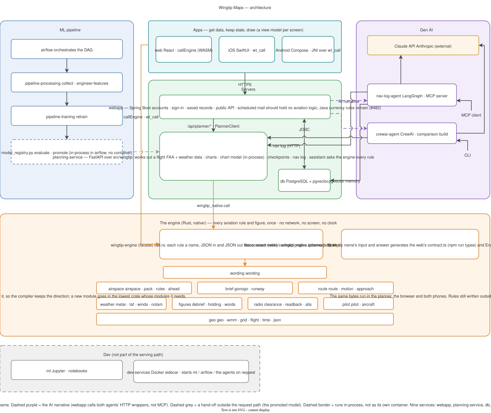
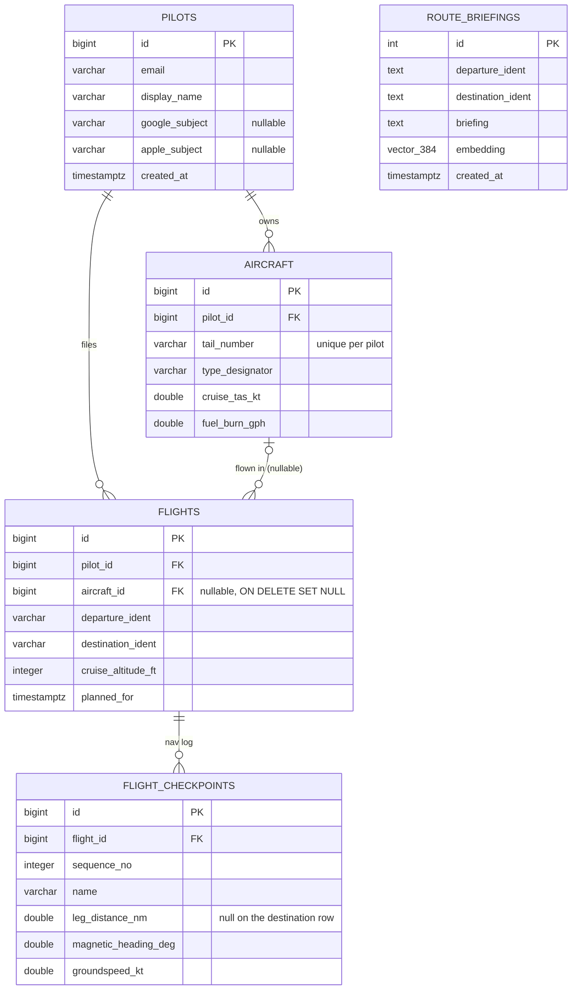

# Wingtip Maps Nav Log Platform


## Contents

- **[Overview](#overview)** — [Highlights](#highlights) · [Architecture](#architecture) · [Tech stack](#tech-stack)
- **[Services & Data Design](#services--data-design)** — [Services in detail](#services-in-detail) · [Database & migrations](#database--migrations)
- **[AWS Target & Status](#aws-target--status)** — [Target architecture (AWS)](#target-architecture-aws) · [Status](#status)
- **[Developer Guide](#developer-guide)** — [Getting started](#getting-started) · [Where things live](#where-things-live) · [Notebooks](#notebooks) · [Testing & CI](#testing--ci)
- **[Appendix](#appendix)** — [Full service command reference](#full-service-command-reference) · [Repository layout, in full](#repository-layout-in-full) · [Notebooks, in full](#notebooks-in-full) · [CI, in full](#ci-in-full) · [Gotchas](#gotchas) · [See also](#see-also)

## Overview

An end-to-end system that generates VFR (Visual Flight Rules) and IFR (Instrument
Flight Rules) flight nav logs: a trained model selects visually identifiable ground checkpoints
along a route, a dead-reckoning engine computes headings, groundspeed, ETE,
and fuel burn from live weather, a rules engine recommends a legal cruising
altitude from terrain/airspace/weather constraints, and a Gen AI agent
assembles it all into a natural-language pilot briefing.

Route: Campbell Airport (C81, Grayslake, IL) → Duluth International
(KDLH, MN).

Built as a full-lifecycle platform engineering project — model training and
selection, orchestrated data pipelines, services and apps over one Rust
engine that holds the aviation rules, and a Gen AI agent with long-term
memory — designed from the outset with an
explicit path to production on AWS.

### Highlights

- **Checkpoints read off the chart itself.** A sectional is a
  cartographic product with a fixed palette, so water, watercourses,
  towns and linework come straight out of the tiles — no Overpass, no
  downloads, a few seconds for a 320 nm corridor. That matters beyond
  speed: the label being learned is "could a pilot spot this *on the
  chart*", so reading the chart makes the ground truth and the training
  signal the same thing rather than filtering an OSM extract down to
  approximate it.
- **scikit-learn model selection.** Each retrain grid-searches Ridge
  regression, Random Forest and Gradient Boosting against a
  predict-the-mean baseline by 5-fold cross-validation and keeps the
  best; the planner scores checkpoints with the promoted model. Notebook
  03 adds nested cross-validation and permutation importance.
- **A repeatable training run.** One command
  (`python -m wingtip.pipeline run`) runs data collection, feature
  engineering, training, evaluation, and model promotion in order — a new
  model only goes live if it beats the currently deployed one on
  held-out metrics. The developer console's Retrain starts it as a
  container and follows it stage by stage. It replaced an Apache Airflow
  DAG (2026-11-06): the DAG had no schedule and was only ever started by
  hand, and a scheduler, a web server and a metadata database for that
  were not worth running.
- **Domain-accurate flight planning.** Dead-reckoning leg calculations
  (wind correction angle, true/magnetic heading, groundspeed, ETE, fuel
  burn) built from FAA-standard formulas against live NOAA winds-aloft and
  magnetic-declination data. Cruising-altitude selection incorporates real
  terrain/obstacle clearance (FAA MEF methodology), live FAA Class B/C/D
  airspace shapefiles, and current METAR/TAF/SIGMET data. Only Class B
  constrains the cruising altitude: C and D need two-way radio
  communication established rather than a clearance, so they are reported
  as calls to make, not airspace to fly beneath.
- **A Gen AI agent with real memory.** A LangGraph agent, exposed as an MCP
  server, assembles the full nav log into a natural-language briefing, with
  long-term recall of past routes via a Postgres/pgvector semantic-search
  store — reusing existing infrastructure rather than standing up a
  separate vector database. Its MCP tools split the deterministic work
  from the one Claude call: an agent that connects with its own model
  can ask for the checkpoints, altitude and legs alone (`assemble_nav_log`,
  no Anthropic key spent) and write its own narrative, or ask for one
  written here (`generate_nav_log_briefing`) the way the webapp does.
- **The same agent task built twice, to compare frameworks.** A second
  implementation in CrewAI — identical tools, identical model-serving
  backend, identical Claude API — evaluates LangGraph's explicit
  state-graph control flow against CrewAI's agent-driven tool selection on
  the same real task this project runs end to end.
- **A cheap path to production**: one EC2 server behind CloudFront, chart
  tiles drawn once a cycle into S3, about $29 a month — see
  [Target Architecture](#target-architecture-aws).
- **CI on every push.** GitHub Actions runs the test suite and lint on
  every push/PR, then builds every service image and publishes it to GHCR
  (and to ECR, once AWS credentials are configured) from `main`.

### Architecture

Four layers, each with one job:

- **The engine** ([`native/`](../native), Rust): every aviation rule and
  figure, once. No network, no screen, no clock of its own. A facade,
  `wingtip-engine`, over nine domain crates in `native/crates` (geo,
  weather, figures, radio, pilot, brief, route, airspace, wording), each
  of which may use only the ones under it. Each rule is a name in
  `native/engine/src/call.rs`, JSON in and JSON out, and its input and
  answer are typed in `native/contract/engine.schema.json`, from which
  the web's and the phones' types are generated.
- **The planner** (`planning-service` over `src/wingtip`, FastAPI):
  works out a flight. It fetches the FAA's and the weather's data, reads
  the chart and scores the checkpoints with the chart model in its own
  process, runs the AI assistant, and asks the engine every rule through
  `wingtip_native.call`.
- **Spring Boot** (`springboot-app`, the `webapp` service): who the pilot
  is and what they saved -- accounts, sign-in, aircraft, flights,
  logbook and endorsements, the public API, scheduled mail. It holds no
  aviation logic: where it needs a figure, such as currency for a
  reminder email, it asks the planner over HTTP (`PlannerClient`), and
  the planner asks the engine.
- **The apps** (`web/`, `ios/`, `android/`): get the data, keep the
  state and draw, with one view model per screen (a hook on the web, an
  observable model on the phones), and ask the engine the rest by name:
  the web through `callEngine` (the engine built to WebAssembly), the
  iPhone through `wt_call`, Android through a JNI shim over `wt_call`.

The owner kept both server languages on this split (2026-11-06). The
boundary between them is plain HTTP and already clean, merging them would
give a pilot nothing, and Spring is good at identity and persistence;
the aviation belongs in the engine, not in either server.

That is the target. Some rules still live outside the engine -- about
7,000 lines in `src/wingtip`, the currency and endorsement rules in the
Java, and some in the web and phone apps -- and issue #482 moves them
in, in phases: copies the engine already has, small rules, weather parsing,
altitude selection, the nav log, then route options.

The system runs today as eight Docker services (`retrain` is the training image run as the whole training run, not an image of its own):

| Service | Role |
|---|---|
| `webapp` | Spring Boot — accounts, sign-in, the pilot's records, the public API and scheduled mail; serves the React app and proxies the planner |
| `nav-log-agent` | LangGraph agent (MCP server) that assembles the full nav log and briefing |
| `crewai-agent` | The same task, built in CrewAI, for framework comparison |
| `db` | PostgreSQL + pgvector — application data and agent long-term memory |
| `pipeline-processing` / `pipeline-training` | Data collection, feature engineering, and model training, run as one-off jobs; `retrain` is the whole training run (`python -m wingtip.pipeline run`) in the training image, the container the developer console's Retrain starts |
| `ml` | Jupyter environment for model development and experimentation -- on demand, behind the `notebooks` profile: `docker compose up ml` |
| `planning-service` | FastAPI: works out a flight for the apps -- course, checkpoints scored by the chart model in-process, nav log, weather, the assistant -- with the engine inside it for every rule |



<sub>Editable source: `architecture-current.drawio`. The rendered SVG has
the diagram embedded in it, so opening `architecture-current.svg` directly
in [draw.io](https://app.diagrams.net) (or the VS Code draw.io extension)
works too. AWS counterpart: `architecture-aws.drawio`, rendered in
[`README-AWS.md`](README-AWS.md).</sub>

### Tech stack

**ML / Data**


**Backend**


**Front end**


**Gen AI**


**Infrastructure**


**Live data sources** (no logos, but they're where the domain accuracy
comes from): the FAA's own VFR Sectional tile service — which the
checkpoint detector reads directly — plus FAA NASR airport, navaid and
obstacle datasets, FAA Class B/C/D airspace shapefiles, NOAA aviation
weather (METARs, TAFs and SIGMETs from aviationweather.gov's cache
files, refreshed every few minutes, rather than a query per route),
the magnetic-declination model, and OpenStreetMap via the Overpass API
for the tabular feature pipeline.

## Services & Data Design

### Services in detail

**`planning-service`** — chart vision, checkpoint selection, the nav log
and the assistant; it asks the engine (`wingtip_native`) for the rules
the engine holds, and #482 moves the rest of its Python rules there.
Serves no pages: the front end lives in [`web/`](../web) and is built
into `webapp`'s jar, which proxies here for every computation. Publishes no
port on AWS either — it sits behind `webapp` in a private subnet, found by
service discovery at `planning-service.wingtip.internal`.

- `/api/course`, `/api/checkpoints`, `/api/navlog`, `/api/detect/stream`,
  `/api/picks`, `/api/chart-tile/{kind}` — reached by the
  browser as `/api/planner/*` on `webapp`, never directly. The tile
  endpoint renders the FAA's own chart GeoTIFFs (`wingtip.charts`, one
  download per sheet per 56-day cycle into `data/raw/charts/`), so the
  map depends on no hosted chart service. Its own OpenAPI page is at
  [`localhost:8084/docs`](http://localhost:8084/docs); the full endpoint
  list is in [`planning-service/README.md`](../planning-service/README.md)
- `/api/overlay-tiles`, `/api/overlay-tiles/{name}.pmtiles` — the map's
  FAA overlays as vector tiles for MapLibre (`wingtip.vector_tiles`): one
  PMTiles archive a cycle, built after the cycle pack by tippecanoe (in
  the planner's image, a pinned tag) and read by the map in byte ranges
  (the `pmtiles` protocol; `web/src/lib/map/overlayTiles.ts` registers it
  and makes the source; Android's and iOS's MapLibre read `pmtiles://`
  themselves). Zooms 4 to 12, lines within `tolerance_m` (4.1 m) of the
  FAA's, nothing dropped for size. A sample of the 29 Oct 2026 cycle,
  92–84 W by 38–46 N (about a tenth of the cycle's features: 522
  airspace volumes, 55 special-use areas, 2,218 airports, 156 navaids,
  6,933 fixes), made an 8.6 MB archive in 90 s (4 s of GeoJSON, 86 s of
  tippecanoe) on the Mac mini. By that, the whole cycle (5,621 volumes,
  1,545 areas, 19,146 airports, 1,511 navaids, 70,060 fixes; 540 MB of
  GeoJSON while it builds) is some 85–95 MB and 15 minutes, once a
  cycle; a map reads only the tiles in view. Its source layers and fields:

  | Layer | From | Fields | First zoom |
  |---|---|---|---|
  | `airspace` | NASR Class_Airspace.shp, Class B–E | `class`, `local_type`, `name`, `ident`, `floor_ft`, `floor_ref` (SFC/AGL/MSL), `ceiling_ft` (MSL), `ceiling_excluded`, `number`, `hours_code`, `hours_remark` | B 4, C 5, D 6, E2–E4 7, E5–E7 8 |
  | `special_use` | FAA special use airspace (ADDS) | `type` (P/R/MOA/W/A/D), `kind`, `name`, `floor_ft`, `floor_ref`, `ceiling_ft`, `ceiling_ref`, `times_of_use`, `time_zone`, `controlling_agency` | 5 |
  | `airports` | NASR APT_BASE, APT_RWY, APT_RWY_END (operational only) | `ident`, `faa_id`, `name`, `type`, `use`, `military`, `towered`, `elevation_ft`, `longest_ft`, `hard_ft`, `runway_true`, `fuel`, `rank` (0 towered … 4 heliport) | by rank: 5, 6, 7, 9, 10 |
  | `navaids` | NASR NAV_BASE (in service) | `ident`, `name`, `kind`, `freq`, `channel`, `service_volume`, `mag_var`, `elevation_ft`, `hours`, `restricted` | VORs 5, others 7 |
  | `fixes` | NASR FIX_BASE, every row | `ident`, `kind`, `vfr`, `enroute_low` | charted 8, others 10 |
- `/api/briefing` — the FAA-sequence weather briefing behind the
  briefing on `/app/plan`, the flight planning drawer (the
  narrative itself comes through `webapp`'s own `/api/comparison`,
  below)
- `/api/assistant` — the pilot's assistant (`app/assistant.py`): a
  question about the flight in the pilot's own words, answered by Claude
  with the planner's own functions as its tools (the plan, the weather at
  a field, the briefing, the Go / No-Go, a field's card, the nearest
  fields, a hold's entry, a diversion), so every figure is the planner's
  and the model only chooses the tools and writes the words; streamed as
  newline-delimited JSON with the raw sources the answer rests on
- `/api/words/{notams,weather,risk,debrief,changes}` — short readings in
  words (`app/words.py`): each sentence cites the raw source it rests on
  by id (a METAR, a NOTAM, a finding), and a sentence with none is
  dropped; `changes` diffs two briefings first and asks the model only
  where something moved, for `webapp`'s flight watch
  (`/api/flights/{id}/watch`: a saved flight re-briefed every half hour
  up to departure, what changed mailed to the pilot)
- `/api/model-comparison` — the scikit-learn models the last retrain
  compared, each by its cross-validated error: the dev console charts
  it, and Plan's info popover names the promoted one from it
- `/api/status`, `/api/retrain`, `/api/aircraft-profiles` — the Dev
  drawer's own snapshot of the stack (services, FAA and weather data
  freshness, the model registry, collected corridors and their labels),
  a retrain (the training run's container, started through the
  dev-services sidecar), and the stock aircraft profiles the nav
  log's aircraft picker offers
- Cruise altitudes — the nav log works the floor and ceiling out leg by
  leg (a Class B shelf caps only the legs under it)
  and offers four plans of the legal altitudes -- the lowest, the
  highest, the fastest for the winds aloft, and the one that burns the
  least fuel, climb and cruise -- every climb flown on
  the leg that makes it, none above 12,500 ft without oxygen -- and
  the nav log header's own "why" popover and the briefing's "Cruise
  Altitude" section walk the pilot through it, step by step. Every leg
  and climb is flown in the day's air (`wingtip.performance`): the
  aeroplane's cruise figures are its own at 6,000 ft on a standard day,
  and the forecast temperature at each leg's altitude gives the density
  altitude its true airspeed, fuel flow and climb rate follow, and
  where the service ceiling is. A
  departure time picks the winds forecast period, gives every row an
  ETA, and sets the fuel reserve (day or night, by civil twilight at
  either end) the totals hold the aeroplane's usable fuel against
- `wingtip.chartvision` reads the corridor's tiles and segments them by the
  chart's own palette, streaming results block by block from the departure
  end. `wingtip.chartlabels` stores what a pilot decides about them, keyed by
  route and position rather than by an OSM id
- Collection for an uncollected corridor runs here, in-process on a
  background thread, rather than by launching a pipeline container — that
  would mean handing this service the Docker socket, a far larger grant
  than it needs

- The chart model's score for each of the chart reader's detections,
  in-process (`app.chart_scorer`), from the promoted model in
  `data/models/chart/current`; while none is promoted, the planner ranks
  by the palette's constants. A promotion (the Dev console's retrain)
  writes new files into that directory, and the planner notices their
  timestamps on its next score and uses the new model without a
  restart. This was a `model-service` container of its own, for this
  one call, until 2026-11-06; scikit-learn and joblib are now pinned in
  the planner's requirements, exactly as the training image pins them

**`springboot-app` (webapp)** — accounts, sign-in and the pilot's saved records, and the public API. No aviation logic: a figure it needs comes from the planner.

- Schema owned by Flyway migrations; JPA's `ddl-auto` only validates against them
- Actuator health probes at `/actuator/health/liveness` and `/actuator/health/readiness`
- Bean Validation on request bodies (`AircraftRequest`, `SaveFlightRequest`) + a global exception handler turn a bad request into a clean `400`, a wrong method into `405` and a duplicate tail number into `409`, not an opaque `500`
- Never scores anything itself: scoring belongs to `planning-service`, which it proxies (`/api/planner/*`). Reads through that proxy are public; writes (checkpoint notes, corridor builds) need a session as soon as the deployment offers a way to sign in (OIDC credentials or a mail host), and the developer's work (picks, a retrain, a chart refresh, the stack's status and services) needs the developer role as well. All of it stays open locally where neither is set
- Sign-in with Google or Apple (OIDC), or a passwordless email magic
  link — OIDC is inactive by default; activate with the `oauth` Spring
  profile once `GOOGLE_CLIENT_ID`/`GOOGLE_CLIENT_SECRET` or all four
  `APPLE_*` vars are set (client registration itself is built in Java,
  `security/OAuthClientsConfig.java`, since Apple's client secret is a
  signed, expiring JWT no static YAML value could hold). The magic
  link (`/api/auth/magic-link`) needs no profile and works whether or
  not OIDC is configured, though sending needs a real `MAIL_HOST` too.
  `/api/me` reports who's signed in; `/api/aircraft` and `/api/flights`
  are that pilot's own aeroplanes and filed flights, each pilot-scoped
  so one can never read or edit another's by guessing an id
- `/api/comparison` (`ComparisonProxyController`) — streams a narrative
  for the nav log the briefing shows, from `nav-log-agent`'s LangGraph
  build (`framework=langgraph`) or `crewai-agent`'s CrewAI build
  (`framework=crewai`), each a real billed Claude call, as
  newline-delimited JSON while Claude writes it. Needs a session
  wherever anyone can sign in. Neither agent is
  required for `webapp` itself to start
- Interactive API docs (springdoc-openapi) at `http://localhost:8080/swagger-ui/index.html`, raw spec at `/v3/api-docs`

**`nav-log-agent`** — a LangGraph agent wrapped as an MCP server.

- Three MCP tools: `assemble_nav_log` and `remember_briefing` (no Anthropic key needed) and `generate_nav_log_briefing`, each taking `departure_ident`, `destination_ident`, and optionally `altitude_ft` and `aircraft_name` (the planner's own choice and default aeroplane when omitted)
- Graph: `fetch_nav_log` (planning-service's `/api/plan`, through `wingtip.planner_client`) → `retrieve_memory` (pgvector, embedded locally with `sentence-transformers/all-MiniLM-L6-v2`, baked into the image) → `generate_briefing` (Claude API, streamed) → `store_memory`. The briefing on Plan, which already has the nav log, POSTs it to `/compare` and the graph starts at `retrieve_memory`
- Served over SSE at `/mcp/sse`
- The nav log it briefs is the planner's own -- the checkpoints, per-leg altitudes, climbs and fuel check a pilot sees -- rather than one it assembles, so the two cannot drift apart

**`crewai-agent`** — the identical task (checkpoints → altitude → legs → briefing), built in CrewAI instead of LangGraph, for framework comparison.

- The same planner answers as `nav-log-agent` (`wingtip.planner_client`); different control-flow model — an `Agent` reasoning over `tools` rather than an explicit function sequence
- Run by hand as a one-shot CLI (`python -m app.main`); `docker compose up` runs a thin HTTP wrapper around the same crew so the briefing on Plan can call it
- No pgvector memory store of its own

### Database & migrations

Two independent schemas on the same `db` Postgres container, each owned by
its service and managed by versioned SQL migrations rather than an ORM
auto-generating schema from code: `public` is the webapp's (Flyway), and
`nav_log_agent` is the agent's. Flyway refuses to migrate a `public` that
holds tables it has no history for, so the agent keeps out of it and the
two can start in either order.



- **`webapp`** (`pilots`/`aircraft`/`flights`/`flight_checkpoints`)
  — Flyway. One pilot's own data, populated once they sign in (see
  [Services in detail](#services-in-detail)) — `aircraft_id` on
  `flights` is nullable and `ON DELETE SET NULL` rather than `CASCADE`,
  since a flown flight is a record that must survive selling the
  aeroplane. Scored corridors are not persisted here at all: they come
  from `planning-service` on demand and are the same for everyone. Add
  a migration as
  `springboot-app/src/main/resources/db/migration/V<N>__description.sql`
  and it runs automatically on next startup. `ddl-auto` is `validate`, so
  drift between the JPA entities and the actual schema fails loudly at
  startup instead of silently altering a table.
- **`nav-log-agent`** (`nav_log_agent.route_briefings`) — a minimal
  versioned-SQL runner (`app/migrations.py`), no ORM. Add a file as
  `app/migrations/V<N>__description.sql`; `ensure_schema()` (called at
  agent startup) tracks applied versions and runs any new ones in order,
  each in one transaction with its history row. Its connections put
  `nav_log_agent` first on the search path, so a migration names its
  tables unqualified.

## AWS Target & Status

### Target architecture (AWS)

One small server behind CloudFront runs what must stay live, and what is
the same for every pilot is drawn ahead of time and served from the edge
— see [`README-AWS.md`](README-AWS.md) for the design, the cost (about
$29 a month) and the runbook.

| Local component | AWS target |
|---|---|
| `webapp`, `planning-service`, `nav-log-agent` | One EC2 server (`docker-compose.prod.yml`), behind Caddy and CloudFront |
| `db` | Postgres on the same server, dumped to S3 nightly |
| Chart tiles | A Fargate Spot task per 56-day cycle, published to S3, served by CloudFront |
| Mailpit | Amazon SES |
| `crewai-agent`, the pipelines and the training run, `ml`, `dev-services` | Development only |
| CI/CD | GitHub Actions → GHCR + ECR, then `deploy.sh` on the server over SSM |

### Status

The ML pipeline and its training run, dead-reckoning engine, altitude
selection logic, both Gen AI agents, and CI are built, integrated, and
working end to end. The AWS side is fully written and validated
(`cfn-lint` clean, every image builds) — see
[`README-AWS.md`](README-AWS.md). Three things remain, and none is
an engineering gap:

- **More ratings for the chart model.** The planner's checkpoints come
  off the chart now, for any route, with no collection step: whatever
  the chart reader finds within a mile of the course, ranked by the
  chart model (`wingtip.chartmodel`) the training page's ratings train --
  0 to 5, a 0 for a detection that is no feature at all (a power line
  read as a road). The first one, on 32 ratings, beats the palette's
  constants on the ratings it held out (MAE 1.89 against 2.00) but not
  yet a guess of the mean (1.78); every rating more, the 0s on the
  reader's mistakes most, is what moves it. Performance shows the three
  side by side.

  The first attempt, before these ratings, is the reason they are rated
  this way: carrying the older OSM ratings onto detections by position
  gave 77 labels, 79% of them 4 or 5, and no model beat the mean on them
  (MAE 0.804). The target had no spread to learn from, and the models'
  strongest feature was distance from the course line -- where the
  cursor went, not what the landmark is -- which is out of the features
  now.

  The OSM landmark model, its collection and its feature stores still
  train in the training run and are compared on Performance; nothing in the
  planner asks them any more.

- **A second route.** Every label so far comes from one corridor, so
  nothing yet proves the model transfers. Route position was dropped from
  the feature set for exactly this reason (see `FEATURE_COLS_BASE`):
  measured over 25-fold repeated CV, a model given *only* where a point
  sat along the route recovered 78% of the full model's gain over a
  predict-the-mean baseline, which is a route being memorised rather than
  spottability being learned.
- **A live AWS deployment.** No AWS account exists in this project's
  environment. Everything that can be verified without one — the
  template, the production compose file, the origin's Caddy gate — has
  been; the owner's account and domain, then `aws cloudformation deploy`,
  are what remain.

## Developer Guide

### Getting started

**Prerequisites:**

- **Docker Desktop** with Docker Compose v2. This project is Docker-only —
  there is no native Python virtualenv.
- **Git.**
- **An Anthropic API key** (`ANTHROPIC_API_KEY`) — only required to run
  `nav-log-agent` or `crewai-agent`, which are the two services behind the
  `ai` Compose profile. Everything else works without one, including every
  `docker compose` command: the key is read with `:-`, not `:?`, precisely
  so that a missing key cannot fail a command that was never going to call
  an LLM. (`planning-service` also calls Claude, for the optional "how to
  spot it" checkpoint notes; without a key that one endpoint returns an
  error and the rest of the planner is unaffected.)
- **AWS CLI + credentials** — only required for an actual AWS deploy; local
  development works without them. See [`README-AWS.md`](README-AWS.md).

**First-time setup:**

```bash
git clone <repo-url>
cd wingtip

# Only needed for nav-log-agent / crewai-agent:
export ANTHROPIC_API_KEY=sk-...
# or put it in a .env file (gitignored) at the repo root — docker compose
# reads .env automatically.
```

Nothing else to install natively; every service builds its own image.

**Repository layout:**

```
data/             raw/processed/labels/aircraft/models — see Appendix for detail
notebooks/        numbered, run-in-order exploratory notebooks (01-08)
src/wingtip/          shared Python package — pipeline.py, model_registry.py, navlog.py, altitude.py, etc.
docker/           Dockerfiles + requirements for ml / pipeline-processing / pipeline-training
                  (each including wingtip's own list, src/requirements.txt)
springboot-app/   Spring Boot API (webapp) — routes, DB, proxies planning-service
nav-log-agent/    LangGraph agent (MCP server) — assembles the full nav log + briefing
crewai-agent/     the same task, built in CrewAI, for framework comparison
infra/            CloudFormation template and the production server's files
tests/            pytest suite for src/wingtip
docs/             this file, README-AWS.md, LEARNING-GUIDE.md, architecture diagrams
```

**Running the stack:** each service is a `docker-compose.yml` entry —
bring up only what you need. Full command reference is in the
[Appendix](#appendix); the essentials:

```bash
docker compose up webapp                           # UI + API at :8080; brings up db, planning-service
docker compose up ml                               # Jupyter at :8888 (token "wingtip")
docker compose up nav-log-agent                    # MCP server at :8082
docker compose run --rm crewai-agent python -m app.main \
  --departure-ident C81 --destination-ident KDLH   # one-shot CLI
```

**On a phone, on the same Wi-Fi:** the webapp's ports are on this
machine's loopback by default, because with no sign-in configured every
planner write is open to whoever can reach them. `docker-compose.phone.yml`
publishes webapp alone on every interface, for as long as you are
testing on a network you trust. `http://<your Mac's address>:8080/app/plan`
then works for planning, but the two things a pilot wants in the air --
their own position on the chart, and the route's charts with no
connection -- the browser grants only to a secure origin. So the webapp
also listens on HTTPS once it has a certificate:

```bash
infra/local-https/make-certs.sh 192.168.1.42   # your Mac's LAN address; writes infra/local-https/certs/
docker compose -f docker-compose.yml -f docker-compose.phone.yml up -d webapp
                                               # now also https://192.168.1.42:8443
```

Install `certs/ca.pem` on the phone once (the script prints the steps
for iPhone and Android), then open `https://<address>:8443/app/plan`.
The authority's own key stays out of the repo, in `~/.config/wingtip-local-ca`:
the repo is mounted read-write into most services, and whoever holds that
key can mint certificates the phone trusts. A new authority is also
name-constrained to private addresses and `localhost`; one made before
that is not, and `make-certs.sh --new-ca <address>` replaces it (install
the new `ca.pem` on the phone afterwards).
From there the map's info popover offers **Show my position** (the GPS as
a blue arrow, and the map kept on it until you pan) and **Keep this
route's charts on this device** (every sectional tile within 10 nm of
the course, whole-route view to full detail, held by the app's service
worker along with the course, checkpoints and nav log, so the route
opens again with the network off). The briefing and the airports'
weather are not kept: a cached METAR could only ever be shown as if it
were current, so with no network they say the weather could not be
checked. Add the page to the home
screen and it opens as an app. On AWS the load balancer terminates TLS
and all of this simply works at the site's own address.

### Where things live

Every address the running stack answers on, verified against a live
stack. Anything not listed here does not exist.

| What | URL | Needs |
|---|---|---|
| **Route planner** — the map with the flight planning drawer beside it: the nav log, walked with the arrow keys or a click, and under it the FAA-sequence briefing with its LangGraph/CrewAI narrative popover and Print. Also the app's homepage, bare `/app` redirects here | [`localhost:8080/app/plan`](http://localhost:8080/app/plan) | `webapp` + `planning-service` |
| **Dev** — the developer's page: the labeling page above, with the developer's console (model registry and retrain, corridors and their labels, service and data status) in a drawer over the chart. `/app/label` and `/app/settings` redirect to Dev and Plan | [`localhost:8080/app/dev`](http://localhost:8080/app/dev) | `webapp` + `planning-service` |
| Spring Boot API docs | [`localhost:8080/swagger-ui/index.html`](http://localhost:8080/swagger-ui/index.html) | `webapp` |
| Spring Boot OpenAPI spec | [`localhost:8080/v3/api-docs`](http://localhost:8080/v3/api-docs) | `webapp` |
| Health / readiness | [`localhost:8080/actuator/health`](http://localhost:8080/actuator/health) | `webapp` |
| Planning + chart-vision API docs | [`localhost:8084/docs`](http://localhost:8084/docs) | `planning-service` |
| Jupyter | [`localhost:8888`](http://localhost:8888) (token `wingtip`) | `ml` |

All three pages are served by `webapp`, not by `planning-service`: the
React app in [`web/`](../web) is built into the Spring Boot jar, and the
browser reaches the Python service only through `webapp`'s
`/api/planner/*` proxy. `docker compose up webapp` starts
`planning-service` with it. Hitting port 8084 directly works and is
useful when debugging, but nothing in the front end does it.

A request crosses three services, each with one job, and the engine
answers the rules on either side:

```
browser (web/)   the map, the keyboard, the rows; asks the engine (WebAssembly) for what it draws
  -> webapp        :8080  serves the page, proxies /api/planner/*, owns auth and the database
  -> planning-service    :8084  reads sectional tiles, scores them with the chart model, checkpoint selection, nav log; asks the engine every rule
  -> db            :5432  pilots, flights, agent memory
```

Despite its name, `planning-service` serves no pages; see [Services in detail](#services-in-detail).

### Notebooks

Notebooks 01-03 walk through what `pipeline.py` automates, and call it:
01 and 02 run `collect` and `engineer_features` and read the tables back,
so a notebook and the training run can never write two different data files; 03
takes its labelled table and holdout from `pipeline.labeled_split`, the
one every trainer uses. 08 walks the altitude selection one step at a time with `wingtip.altitude`'s
own pieces and checks its answer against the planner's. Run them via `docker
compose up ml`. Full per-notebook breakdown is in the
[Appendix](#appendix).

### Testing & CI

```bash
# Python (src/wingtip). The pipeline images carry no test tooling -- this
# runs what CI runs, from requirements-dev.txt.
# libexpat1 is the one system library rasterio's wheel needs that the
# slim image leaves out.
docker run --rm -v "$PWD":/w -w /w -e PYTHONPATH=/w/src python:3.14-slim \
  sh -c "apt-get update -qq && apt-get install -y -qq libexpat1 && pip install -q -r requirements-dev.txt && ruff check src/wingtip tests && pytest tests/ -q"

# planning-service (its own FastAPI-layer suite, separate from the one
# above since it needs the service's own requirements on top of pytest)
docker run --rm -v "$PWD":/w -w /w/planning-service python:3.14-slim \
  sh -c "pip install -q -r requirements-dev.txt && ruff check app tests && pytest tests/ -q"

# nav-log-agent and crewai-agent: the same shape, each from its own
# directory and requirements-dev.txt. nav-log-agent wants the CPU torch
# wheel first (`pip install torch --index-url
# https://download.pytorch.org/whl/cpu`), as its Dockerfile does.

# Web front end (web/): typecheck plus unit tests. No browser needed:
# the filters, ordering, rating and nav-log rules are pure functions.
docker run --rm -v "$PWD":/w -w /w/web node:26-slim \
  sh -c "npm ci && npm run types && npx tsc --noEmit && npx vitest run"

# Java (webapp). No native Maven needed, matching the rest of this
# project; the Docker socket is mounted through so Testcontainers can
# start its Postgres as a sibling container.
docker run --rm -v "$PWD/springboot-app":/build -w /build \
  -v /var/run/docker.sock:/var/run/docker.sock \
  --add-host=host.docker.internal:host-gateway \
  -e TESTCONTAINERS_HOST_OVERRIDE=host.docker.internal \
  maven:3.9.16-eclipse-temurin-25 mvn -B test
```

(CI runs `mvn test` directly instead — a GitHub runner has Maven and a
local Docker daemon, so it needs none of the socket/host plumbing above.)

Five suites, split by what each can actually prove:

- **`tests/`** (pytest) — the pure-logic parts of `src/wingtip`: geo math,
  engineered features, dead-reckoning, the model registry, the
  remote-URI guards, plus (mocked, no live network) `wingtip.weather`'s
  METAR parsing and `wingtip.airports`' runway/frequency lookups.
- **`planning-service/tests/`** (pytest, its own suite) — the HTTP
  contract for the endpoints with no coverage anywhere else
  (`/api/model-comparison`, `/api/checkpoints`' error translation):
  status codes, response shape, and that a `WeatherServiceError`
  anywhere underneath reaches the caller as a clean `502`, not a raw
  `500`; plus that the committed `openapi.json`
  (which `web/` generates its API types from) matches the app, and the
  chart model's scores and the reload of a newly promoted model against
  real joblib files in a temporary directory.
- **`nav-log-agent/tests/`** and **`crewai-agent/tests/`** (pytest) — the
  agents' own logic with the database, planning-service and Claude
  mocked: what goes into the briefing prompt, that a failed narration is
  never stored as precedent, and that a request missing its legs is
  refused before any crew is built.
- **`springboot-app/src/test/`** (JUnit) — that the committed
  `springboot-app/openapi.json`, which `web/` generates its types for
  this app's endpoints from, is the document the app serves
  (`OpenApiDocumentTest`; regenerate with `WRITE_OPENAPI=1`); the HTTP contract via
  `@WebMvcTest` (validation `400`s, `405` for a wrong method, the `409`
  on a duplicate tail number), Mockito-backed
  service tests for the pilot-scoping guards (`AircraftServiceTest`,
  `FlightServiceTest`), the DTO→entity conversion, and a
  Testcontainers-backed test that boots a real Postgres to verify
  Flyway's migrations apply and that `ddl-auto: validate` accepts the
  JPA entities against the resulting schema — so entity/schema drift
  fails CI rather than a deploy.

Deliberately left to manual verification: anything needing live network
calls or a trained model (`collect`, `engineer_features`, `retrain`,
`wingtip.altitude`, `wingtip.airspace`) — mocking those would test the mock, not
the upstream data contract that actually breaks.

`.github/workflows/ci.yml` runs every suite on every push/PR. Full
CI job breakdown is in the [Appendix](#appendix).

## Appendix

### Full service command reference

| Command | What it does | Port |
|---|---|---|
| `docker compose up db` | PostgreSQL + pgvector | `5432` |
| `docker compose up webapp` | Spring Boot API and the three browser pages; brings up `db` and `planning-service` too | `8080` |
| `docker compose up ml` | Jupyter, for notebooks 01-03 and 08 | `8888` (token `wingtip`) |
| `docker compose run --rm pipeline-processing collect` | Runs `pipeline.collect()`: downloads a corridor's candidates once, and again only with `--refresh` | — |
| `docker compose run --rm pipeline-processing engineer-features` | Runs `pipeline.engineer_features()` | — |
| `docker compose run --rm pipeline-training retrain` | Runs `pipeline.retrain()` | — |
| `docker compose run --rm pipeline-training python -m wingtip.model_registry evaluate` | Runs `evaluate`/`promote` | — |
| `docker compose run --rm pipeline-training run` | The whole training run, every stage in order (`pipeline.run()`); each model promoted only if it beats the one serving. The console's Retrain starts the same thing as the `retrain` container (`docker compose create retrain` once) | — |
| `docker compose up nav-log-agent` | LangGraph MCP server (needs `ANTHROPIC_API_KEY`) | `8082` |
| `docker compose run --rm crewai-agent python -m app.main --departure-ident C81 --destination-ident KDLH` | One-shot CrewAI CLI (needs `ANTHROPIC_API_KEY`) | — |
| `docker compose up planning-service` | Planning + chart-vision API; `webapp` proxies to it and starts it | `8084` |

Notes:

- `pipeline-processing`/`pipeline-training` are separate images on purpose
  — they mirror the AWS Processing-Job/Training-Job split. They are jobs,
  not services, behind the `pipeline` profile: a plain `docker compose up`
  leaves them out (the training image's default command is a full
  retrain), and naming one in `run` or `build` works as it always did.
- The training run writes each stage's start and end to
  `data/models/run.json`, which the planner reads, beside the `retrain`
  container's state from the dev-services sidecar, for the console's
  Training group. One run at a time: a second waits on the first's lock.
- `nav-log-agent`/`crewai-agent` are behind the `ai` profile, so a plain
  `docker compose up` leaves them out. Start them with
  `docker compose --profile ai up -d`, or by naming one
  (`docker compose up -d nav-log-agent`), which enables its profile.
- `nav-log-agent` needs `NAV_LOG_AGENT_API_KEY` (its own bearer token,
  any string — unset, it exits saying it "refuses to start
  unauthenticated") but **not** an Anthropic key: its MCP tools compute
  the nav log and leave the narrative to the agent that connected. Only
  `generate_nav_log_briefing` and the flight planning drawer's streamed narrative
  spend Anthropic credit. `crewai-agent` needs a key for everything.
- Full port list: `webapp` 8080, `db` 5432
  (`wingtip`/`wingtip`/`wingtip`), `nav-log-agent` 8082,
  `planning-service` 8084, `ml` 8888. Addresses are in
  [Where things live](#where-things-live).

### Repository layout, in full

```
data/
  raw/            downloaded OSM/FAA/elevation/magnetic-variation data and the
                  chart tile cache (gitignored, regenerable)
  processed/      cleaned feature tables
  labels/         hand-labeled spottability ratings — chart_picks.csv is the
                  current one, rated on the chart itself
  aircraft/       aircraft performance profiles (c172.json, etc.)
  models/         trained model artifacts (candidate/, current/, versions/<timestamp>/)
```

### Notebooks, in full

| # | Notebook | What it does | Automated as |
|---|---|---|---|
| 01 | `data_collection` | Pulls candidate checkpoints along the route corridor (OSM + FAA NASR) | `pipeline.collect` |
| 02 | `feature_engineering` | Builds the model feature table | `pipeline.engineer_features` |
| 03 | `sklearn_baseline` | Hand-labeling + Ridge/RandomForest/GradientBoosting selection, nested CV | `pipeline.retrain` |
| 08 | `altitude_selection` | Terrain/obstacle floor, Class B/C/D airspace, weather, aircraft ceiling → recommended cruise altitude | `wingtip.altitude` |

(Numbers 04 to 07 are unused: 04, 05 and 06 compared PyTorch, Keras,
sentence-transformers and Spark MLlib with the scikit-learn baseline,
and went on 2026-11-06, since only scikit-learn reaches a pilot.)

### CI, in full

`.github/workflows/ci.yml` — eleven jobs, on push to `main`, on every
pull request, and by hand (`workflow_dispatch`, the Actions tab's own
"Run workflow" button) — added after a run failed at the platform
level (a runner that never started; every job completed in about two
seconds with no steps executed) and the only way to ask again was an
empty commit:

| Job | What it does |
|---|---|
| `test` | ruff + pytest over `src/wingtip` |
| `changes` | A path filter (`dorny/paths-filter`) telling both `build-images` and `docs` which service images a change could have touched. Runs on pull requests (where `build-images` uses it to build only the touched images) and on pushes to `main` (where `build-images` ignores it on purpose — main's images stay fully in sync with every dependency bump — but `docs` uses it to skip the three heavy `pdoc` steps below when nothing they document changed). |
| `test-web` | `tsc --noEmit`, `vitest` and a production build over `web/` — filters, ordering, what counts as rated, and which leg leaves a checkpoint, all pure functions needing no browser |
| `test-webapp` | `mvn test` — webapp's JUnit suite, including the Testcontainers Postgres test |
| `e2e` | The browser suite (`web/e2e`, Playwright) against the stack a pilot uses — the webapp and the planner built from the commit, Postgres and Mailpit — under `docker-compose.ci.yml`, with the planner's reference data (about a gigabyte it fetches for itself) kept in the Actions cache between runs. Run on every push, and on a pull request that touches anything the stack is built from. Its images and the page are built once for each content key by `build (e2e)` and pulled by all eight shards, on a push and on a pull request from one of this repository's branches; only a fork's or Dependabot's pull request, whose token cannot push, has each shard build its own. |
| `test-planning-service` | ruff + pytest over `planning-service/tests/` — its own dependency set (`planning-service/requirements-dev.txt`), separate from `test`'s unrelated `src/wingtip` ones |
| `test-nav-log-agent` / `test-crewai-agent` | ruff + pytest over each agent's `tests/`, on that agent's own requirements; the database, planning-service and Claude are mocked, so nothing is billed |
| `docs` | Regenerates Javadoc + godoc on every push/PR. The three `pdoc` steps -- run only on pushes to `main`, and only for whichever of `src/wingtip`, `nav-log-agent` or `crewai-agent` `changes` says actually changed; a push that only touched `web/` skips all three rather than paying six figures of milliseconds to rebuild and re-document code nobody edited. Output uploads as a `documentation` artifact. |
| `build-images` | Builds every service Dockerfile, publishes each to GHCR on push to `main`. Every Python image's last build step imports that service's own code and the packages it imports lazily (`import app.main, rasterio.vrt, …`, `import wingtip.pipeline, …`), so a missing dependency fails the build -- here and in a local `docker compose build` alike -- the check that would have caught 2026-09-22's missing `pyproj` in four images |
| `push-ecr` | Copies the three images the CloudFormation stack deploys (`webapp`, `planning-service`, `nav-log-agent`) from GHCR to ECR as `sha-<commit>` and `latest` via OIDC, the images CI tested rather than a rebuild, in the `production` environment the deploy role trusts; activates automatically once `AWS_ROLE_ARN`/`AWS_REGION` repo variables exist |

`build-images` gates on the test jobs, so a failing test never produces a
published image. A cold run (every cache empty, every path filter
saying "changed") takes about six minutes; a push that only touches one
service is under two.

### Gotchas

Non-obvious things worth knowing up front:

- **`Path("s3://bucket/x")` silently collapses to `"s3:/bucket/x"`**
  under `pathlib` normalization. Code rejecting a remote URI must check
  the raw string for `"://"` *before* wrapping it in `Path(...)`. See
  `_reject_remote_uri()` in `src/wingtip/model_registry.py`, which `src/wingtip/pipeline.py` uses too.
- **`docker compose up <service>` reuses a stale container** if the image
  was rebuilt but the container wasn't recreated. Use
  `docker compose up -d --force-recreate <service>`.
- **`crewai` needs the `anthropic` extra installed explicitly**
  (`crewai[anthropic]`) — plain `crewai` raises `ImportError` the moment
  an `Agent` with `llm="anthropic/<model>"` is constructed.
- **An MCP server library's SSE transport defaults to binding
  `127.0.0.1`**, unreachable from outside its own container — Docker's
  port mapping and an ALB target group both need `host="0.0.0.0"` passed
  explicitly (`nav-log-agent/app/main.py`).
- **A Maven `pom.xml` XML comment containing a literal `--`** breaks
  Maven's POM parser with an opaque `Non-parseable POM` error.
- **Recent numpy/pandas/scipy/pyarrow wheels have dropped Intel-macOS
  support**, one reason this project runs entirely in Docker.
- **`data/raw/` (~600MB) must stay in `.dockerignore`** — these services
  mount the project directory at runtime, well after any build step.
- **A repo checked out under an iCloud-synced folder (`~/Desktop`,
  `~/Documents`) accumulates conflict copies**, named `<file> 2.<ext>`
  or `<file> 3.<ext>` beside the original, whenever two processes (or a
  disk-full write racing a sync) touch the same file. Seen for real in
  `springboot-app/target` (breaks Flyway's migration versioning),
  `data/raw` (an airport CSV, and once the whole pickled Class B
  airspace cache — the real filename ends up absent, the conflict copy
  holds the actual data), and `web/src` (a stale duplicate of a
  component, imported by nothing, silently out of date). None of them
  are a code problem; deleting the conflict copy and, for a derived
  cache, letting the code regenerate the real file is always the fix.
  A service that was already running when the corruption happened may
  need restarting even after the file is fixed — a lock or an
  in-process cache can stay wedged on stale state that a fresh process
  wouldn't have. `.gitignore`'s `* [0-9].*` catches the web-source case
  so one can never be committed by accident; it cannot stop them from
  appearing on disk in the first place.

### See also

| Doc | Read it when you want to... |
|---|---|
| [`README-AWS.md`](README-AWS.md) | See the target architecture diagram box by box, and deploy it. |
| [`LEARNING-GUIDE.md`](LEARNING-GUIDE.md) | Understand *why* it's built this way, concept by concept, well enough to build something like it yourself. |
